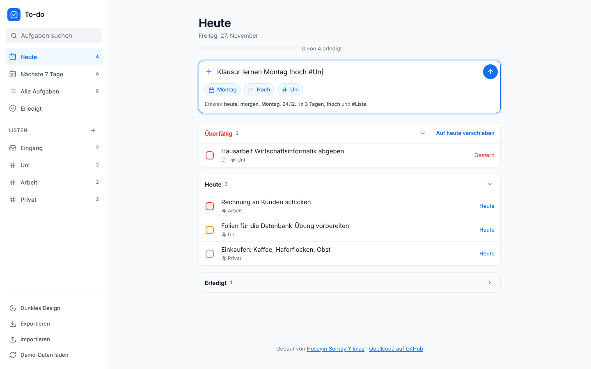
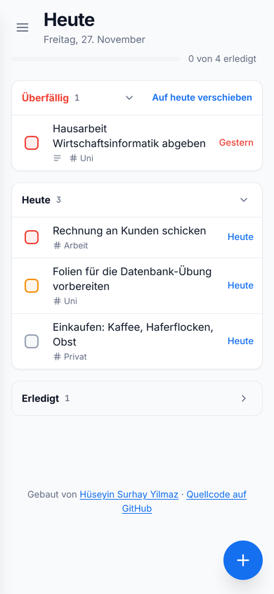
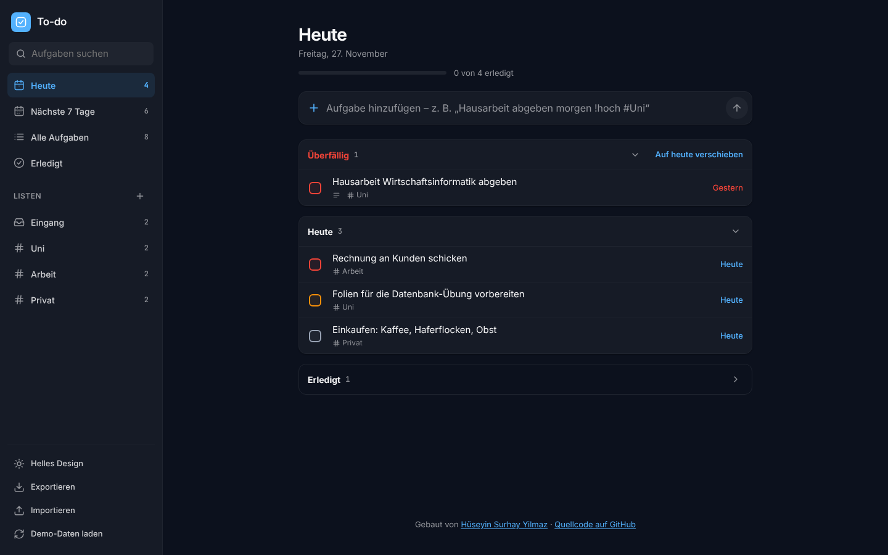

# ✅ To-do

[](https://github.com/Surhay276/todo-app/actions/workflows/ci.yml)


Eine To-do-App im Stil von TickTick – ohne Framework, nur HTML, CSS und modernes JavaScript.

**▶ Live-Demo: [surhay276.github.io/todo-app](https://surhay276.github.io/todo-app/)**



<p>
  
  
</p>

## Funktionen

- **Schnelleingabe in natürlicher Sprache**: `Hausarbeit abgeben morgen !hoch #Uni` → Titel, Datum, Priorität und Liste werden erkannt und live als Chips angezeigt. Versteht `heute`, `morgen`, `übermorgen`, Wochentage, `nächste Woche`, `in 3 Tagen`, `in 2 Wochen`, `24.12.`, `15.01.2027`, `!hoch|!mittel|!niedrig` (oder `!3/!2/!1`) und `#Liste`.
- **Intelligente Ansichten**: Heute (inkl. Überfälligem), Nächste 7 Tage, Alle Aufgaben, Erledigt – plus eigene **Listen**
- **Gruppierung nach Fälligkeit**: Überfällig · Heute · Morgen · Diese Woche · Später · Ohne Datum; Überfälliges mit einem Klick **auf heute verschieben**
- **Prioritäten** als farbige Checkbox (wie bei TickTick), Sortierung nach Datum und Priorität
- **Detailansicht** mit Schnellwahl für Datum, Priorität, Liste und Notizen – speichert automatisch
- **Tagesfortschritt**, Suche, **Rückgängig** nach Abhaken/Löschen, Tastenkürzel `n` für neue Aufgabe
- **Mobil optimiert**: Listen als Schublade, schwebender Button, Schnelleingabe und Details als Bottom-Sheet, 44-px-Touch-Ziele
- Speicherung im `localStorage`, **JSON-Export/-Import**, heller Standard-Modus und Dark Mode

## Entscheidungen

**Warum ohne Framework?** Für eine App dieser Größe reicht modernes JavaScript. Kein Build-Schritt, keine Abhängigkeiten – dafür eine klare Trennung: `todo.js` enthält nur Logik und ist ohne Browser testbar, `app.js` kümmert sich um die Darstellung.

**Warum ein eigener Datums-Parser statt einer Bibliothek?** Die Schnelleingabe soll deutsche Formulierungen verstehen („übermorgen“, „in 2 Wochen“, „24.12.“). Ein kleiner, gezielter Parser mit Tests für Sonderfälle (Jahreswechsel, 31.02., „Donnerstag“ an einem Donnerstag) ist übersichtlicher als eine große Allzweck-Bibliothek.

**Warum unveränderliche Zustände?** Jede Aktion erzeugt einen neuen Zustand statt den alten zu verändern. Dadurch ist „Rückgängig“ trivial (vorherigen Zustand wiederherstellen) und Fehler lassen sich in Tests leicht nachstellen.

**Warum Vorbilder statt eigener Erfindung?** Aufbau und Interaktionen orientieren sich an TickTick (recherchiert über Mobbin): Gruppen nach Fälligkeit, Priorität als Farbe der Checkbox, „Verschieben“ für Überfälliges. Bewährte Muster sind für Nutzer sofort verständlich.

## Technische Umsetzung

| Bereich | Umsetzung |
|---|---|
| Architektur | Logik (`js/todo.js`) strikt getrennt von der Darstellung (`js/app.js`) |
| Zustand | Immutable Updates – jede Aktion liefert einen neuen Zustand, danach `save()` + `render()`; Rückgängig = vorheriger Zustand |
| Parser | Regex-basierte Erkennung deutscher Datumsangaben inkl. Jahreswechsel, ungültiger Daten (31.02.) und „nächster Wochentag“ |
| Sicherheit | Ausgabe ausschließlich über `textContent` (kein XSS); Importe werden validiert und bereinigt |
| Tests | 13 Unit-Tests mit `node:test` – Ansichten, Gruppierung, Parser, Import |
| Design | Untitled-UI-Tokens, Aufbau nach TickTick (Recherche über Mobbin), SVG-Icons, Schriften lokal gehostet (DSGVO) |
| Barrierefreiheit | Semantische Buttons, `aria-pressed`/`aria-current`, sichtbarer Fokus, `prefers-reduced-motion` |
| CI/CD | GitHub Actions testet jeden Push, Deployment über GitHub Pages |
| Aktualität | Die Seite fragt beim Öffnen `version.json` am Cache vorbei ab und lädt sich bei einer neueren Version einmal frisch – so sieht niemand eine veraltete Version (`node scripts/bump-version.mjs` zählt alle Versionsangaben hoch) |

```
todo-app/
├── index.html         # Layout, Icons, Detail-Dialog
├── css/style.css      # Tokens, Layout, mobile Sheets
├── js/todo.js         # Logik: Aufgaben, Ansichten, Gruppierung, Parser
├── js/app.js          # Rendering, Events, Persistenz
└── tests/todo.test.js # Unit-Tests
```

## Lokal starten

```bash
git clone https://github.com/Surhay276/todo-app.git
cd todo-app
npm start   # statischer Server
npm test    # Unit-Tests (Node ≥ 20)
```

---

Entwickelt von **Hüseyin Surhay Yilmaz** · Lizenz: MIT
